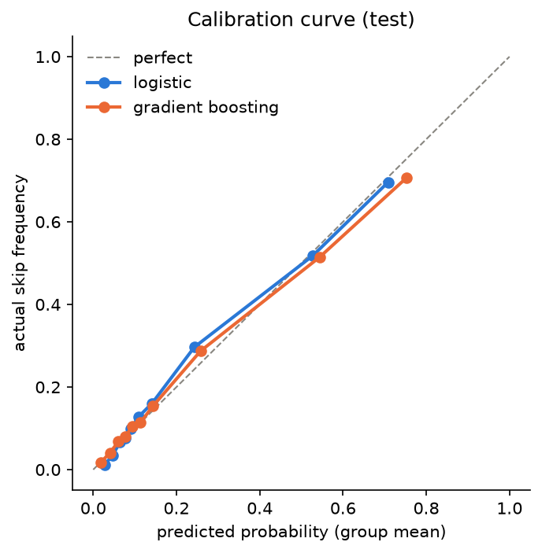
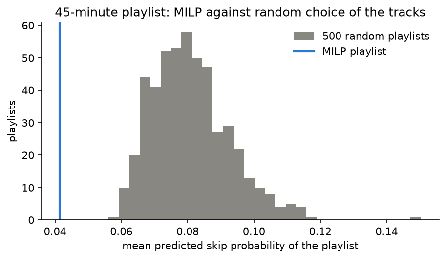
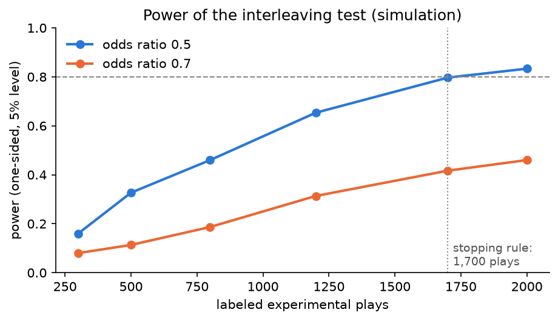

# Optimized playlists from my Spotify listening data

[](https://github.com/francescocodeca/spotify-playlist-optimizer/actions/workflows/tests.yml)

**Predict, decide, verify** on six years of my own listening history (about 111,000 music plays since 2020, from Spotify's extended streaming history):

1. **Predict:** a logistic regression estimates the probability that I skip a track, validated over time only.
2. **Decide:** a mixed-integer linear program (MILP, PuLP + HiGHS) uses these probabilities to choose the tracks of a playlist under duration, artist, novelty and track-length constraints.
3. **Verify:** a pre-registered experiment on myself compares the optimized tracks with tracks chosen without the predictions, mixed in the same playlist (interleaving). **Running since 2026-10-26**, result expected in spring 2027.

**Results so far**

- Model: AUC 0.836 on the test period; well calibrated (mean prediction 0.203 against an actual skip rate of 0.209), which matters because the MILP uses the probabilities as numbers.
- Playlist: mean predicted skip probability 0.041 against 0.081 for random playlists from the same candidates.
- Two extensions tested and dropped with data: optimizing the order of the tracks and a joint MILP over a week.
- Not verified yet: these are predicted values. The experiment will measure real skips.

## 1. Predict: skip probability

- **Label:** a play ends with the forward button (skip) or plays to the end. Plays where I chose another track or that were interrupted are censored, not counted as non-skips.
- **Features:** history of the track and of the artist (skip rates with exponential decay and shrinkage towards the recent global level), plays so far, days since the last play, context (hour, weekend, device, shuffle, abroad) and whether the previous track was skipped. All computed only from earlier plays.
- **Validation:** temporal split (test from 2025-07) and a backtest with 7 rolling cuts. The logistic regression beats gradient boosting and simple baselines.
- **Honest reading:** after a non-skipped track, the case a playlist relies on, the AUC is 0.726 against 0.713 for the track's own skip rate. The gain comes from the quality of the track history, not from model complexity. Performance is reported separately for known tracks, new tracks of known artists and new artists (cold start).



## 2. Decide: a MILP that chooses the tracks

Binary variable per candidate track (4,323 candidates). Objective: maximize the expected minutes listened, (1 − 0.8·p) × duration. Constraints:

- total duration in a window (e.g. 40–45 minutes);
- at most 2 tracks per artist;
- a share of new tracks between 10% and 40% (a ratio, linearized);
- a cap on the excess length of long tracks, plus a small penalty in the objective. A hard threshold was exploited by the solver (a 7.7-minute track plus one just below the threshold); the continuous penalty removes long tracks at a cost of 0.002 expected minutes.

HiGHS solves it in about half a second; the LP relaxation is almost integral. A greedy rule reaches almost the same objective but violates the novelty constraint: the value of the MILP is that all constraints hold together.

**What the constraints cost.** The dual prices of the LP relaxation, checked by solving the MILP again with each parameter changed: one more minute of playlist is worth 0.97 expected minutes (the value of the marginal track), while every other constraint is almost free (0.009 expected minutes from 2 to 3 tracks per artist; exactly 0 for the constraints with slack). Even a playlist of only new tracks costs 0.10 expected minutes out of 43.5. The constraints shape the playlist at almost no cost to the objective.



**What I dropped, with numbers**

- *Order of the tracks* (an orienteering problem): in the data there is no effect of the pair of consecutive tracks where shuffle makes the order random, and with the model the best and worst of 20,000 orders differ by 0.004 expected skips (notebook 04).
- *Joint MILP over 7 days* with a rotation constraint: a daily MILP after removing recently used tracks gets within 0.02 expected minutes of the joint upper bound, while the joint model is slowed down by symmetry between days (notebook 03).

## 3. Verify: an experiment on myself

**Question.** Are the tracks chosen by the MILP skipped less often than tracks chosen without the predictions, under the same constraints? One-sided test, pre-registered in [`docs/experiment_protocol.md`](docs/experiment_protocol.md) before the first upload.

**Design: interleaving**, the method used to compare recommender systems.

- One private Spotify playlist, replaced automatically every Monday through the Spotify Web API: 300 minutes of MILP tracks and 300 minutes of control tracks, mixed in random order. The arm of each track is saved but not looked at before the analysis.
- Control arm: the same MILP with a random value per minute instead of the predictions, so the two arms have the same constraints: duration, artists per playlist, limits on the share of new tracks (10–40%) and on long tracks. They differ only in the use of the predictions. Within the limits the MILP picks more new tracks (28.7% against 13.4% over the planned weeks), because the model predicts low skip probabilities for them: the results for known and new tracks are reported separately.
- Listening is free (any time, any amount). While the playlist plays: normal shuffle, no queue, no click on a specific track.
- Why not one playlist per day, alternating the arms: plays in the same session and day are correlated (intraclass correlation 0.19 within a session), so 40 plays of one day are worth only 7–13 independent plays (design effect 3.0–5.5). With interleaving both arms share every session, and the session effect cancels out.

**Analysis** (`src/analysis.py`, tested on simulated data before any real outcome).

- Experimental plays are found in the streaming history, which does not record the playlist: a play of a track of the active playlist, inside a run of at least 3 such plays in the same session. On ten months of 2026 listening this rule finds 0.14 plays per week by chance.
- Primary metric: skip rate per arm, with difference and odds ratio, and 95% confidence intervals from a bootstrap over sessions.
- Test: permutation test with the arm labels permuted within each session (type I error 0.038 at the nominal 0.05 in simulation).

**Power** (simulation calibrated on my recent listening: skip chains, day and session effects):



Over the 23 planned weeks the predicted contrast stays stable: the mean predicted skip probability of the MILP arm against the control arm has an odds ratio of 0.51 on average (0.46–0.60), with a 4-week rotation of the tracks.

**Status.** Started on 2026-10-26. Stop at 1,700 labeled experimental plays or on 2027-03-31, whichever comes first; then a new export of the history and `python src/analysis.py`. With a smaller effect than predicted, the result will be an estimate with a confidence interval rather than a significant test.

## Limitations

- One listener: the results describe my behaviour, not Spotify users in general.
- Many candidate tracks are tied at the top of the ranking: the MILP separates good tracks from bad ones but chooses almost at random among the good ones.
- The MILP assumes independent skips, so expected minutes are optimistic in absolute terms (fine for choosing tracks, not for forecasting).
- For artists I have never listened to, the model only knows the context.
- Skipping to reach a queued track looks like a real skip in the data; it is a small share of skips.

## Repository

| Path | Content |
|---|---|
| `src/load_data.py` | Loads and cleans the raw export into `data/streams_clean.parquet` |
| `src/features.py` | Label (forward skip against completed play) and features, built only from earlier rows |
| `src/train.py` | Final model; predictions for candidate tracks at a future moment ("virtual rows") |
| `src/candidates.py` | Estimated track durations and candidate tracks |
| `src/playlist.py` | MILP version 1 and the daily playlist with rotation |
| `src/experiment.py` | Weekly playlist of the experiment (both arms) and upload to Spotify |
| `src/spotify_client.py` | Spotify Web API client (OAuth) and the private playlist "Experiment" |
| `src/analysis.py` | Analysis of the experiment: experimental plays, effect with confidence intervals, permutation test |
| `src/simulate_history.py` | Simulated export (real history plus invented plays with a known effect) to check the analysis before the real data |
| `docs/experiment_protocol.md` | Pre-registered protocol of the experiment |
| `notebooks/01_exploration.ipynb` | Exploration: context, track history, sessions, drift, label definition |
| `notebooks/02_model.ipynb` | Baselines, models, calibration, cold start, backtest, decay of the rates |
| `notebooks/03_milp.ipynb` | MILP: solution, long tracks, greedy and random comparisons, LP relaxation, sensitivity, shadow prices, cost of novelty, rotation |
| `notebooks/04_order.ipynb` | Does the order of the tracks matter? |
| `notebooks/05_experiment_design.ipynb` | Design of the experiment: correlation, simulator, power, identification of the plays |
| `notebooks/06_results.ipynb` | Results of the experiment: written and checked on the simulated export before any real outcome |
| `results/` | Figures of this README, saved by notebooks 02, 03 and 05 |
| `tests/` | Automatic tests (`pytest`) on small hand-made cases: label and features (including a check that no feature uses information from the future), MILP constraints, identification of the experimental plays (also on a simulated export), permutation test and bootstrap |
| `.github/workflows/tests.yml` | Runs the tests on GitHub Actions at every push |

## Reproduce

```
conda env create -f environment.yml
conda activate spotify
python src/load_data.py
python src/features.py
python src/train.py
python src/candidates.py
python src/playlist.py "2026-10-26 08:00" --minutes 45
python src/experiment.py 2026-11-02
python src/analysis.py "<folder of a newer export>" --count-only
python src/simulate_history.py
```

The raw data are personal and are not included: the scripts expect Spotify's "Extended streaming history" in `data/Spotify Extended Streaming History/`. The tests need no personal data: run `pytest` from the project folder.
